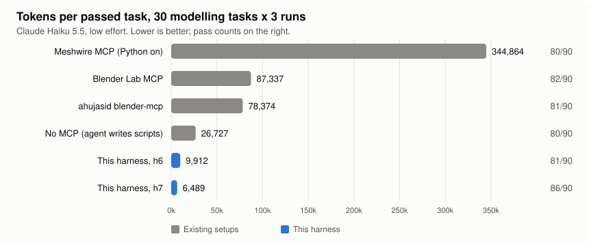
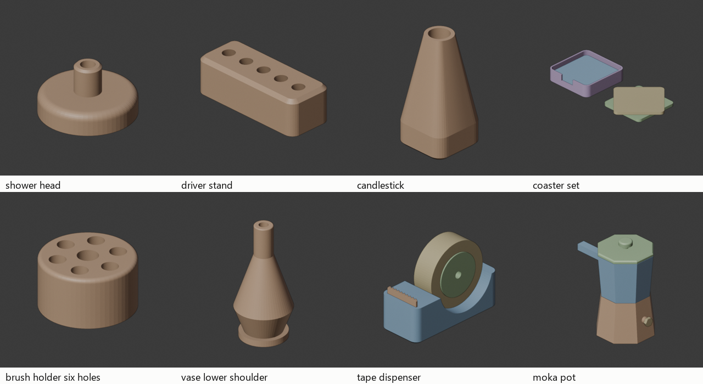

# Agentic 3D

A token-lean agent harness for modelling products in Blender, and the benchmark that measures it.

On 30 product-modelling tasks, an agent using this harness passed 86 of 90 runs at **6,489 tokens per passed task**: about a quarter of the best existing setup (an agent writing its own Blender scripts, 26,727) and a fiftieth of the heaviest Blender MCP server (344,864). On eight tasks written only after the harness was frozen, it passed 20 of 24 runs (baseline 18) at **0.21× the baseline's tokens per passed task**, 0.27× on the typical task, in half the wall time. All runs use Claude Haiku 5.5 at low effort; the whole tuning phase cost about $2.75 of API spend.





*The fourth held-out set as h7 built it: one passing run per task, straight from the recorded scene.*

## Results

| Suite | Setup | Pass | Tokens per passed task | Ratio to no MCP | Typical task (geometric mean) |
|---|---|---|---|---|---|
| Development, 30 tasks × 3 | No MCP | 80/90 | 26,727 | 1.00 | 1.00 |
| | ahujasid blender-mcp | 81/90 | 78,374 | 2.93 | |
| | Blender Lab MCP | 82/90 | 87,337 | 3.27 | |
| | Meshwire MCP (Python on) | 80/90 | 344,864 | 12.9 | |
| | **Harness h7** | **86/90** | **6,489** | **0.24** | **0.29** |
| Fourth held-out, 8 tasks × 3 | No MCP | 18/24 | 58,147 | 1.00 | 1.00 |
| | **Harness h7** | **20/24** | **11,934** | **0.21** | **0.27** |

The held-out set has one task (a revision from four holes to six) that cost the baseline up to 291k tokens a run; without it the ratios are 0.32 overall and 0.34 typical. Earlier harness versions and the three earlier held-out sets are in the journals; `docs/case-study.md` tells the story in order.

## What the harness does

The agent gets one tool: run Python in a Blender session that stays open for the whole task. Around that tool:

- **A scene report after every call** in place of the inspection code agents otherwise write: per object, the face count and bounds, then generic problems (open edges, separate pieces, self-intersections, flipped normals, coincident vertices, parts touching). It never sees a task's checks.
- **An opening read of the existing model** for revisions: levels, a revolved part's profile, round holes with their positions, repeated features with count and spacing, and each flat level's outline. Mining 181 recorded revision runs showed this is what agents spent their first calls measuring; h7 cut revision cost from 21.9k to 5.2k tokens per pass.
- **Auto-finish:** a call marked done ends the run if it raised nothing and the report is clean, so the agent never pays to resend the whole conversation just to say "done".
- **Small generic helpers** (primitives, a lathe, an exact boolean, cleanup) and bounded repair loops.

## How it's measured

- **Tasks** are hypothetical products in four groups: hard-surface parts, layouts, client-style revisions to an existing model, and multi-part builds. Each has a prompt, an optional starting scene, and automatic checks (bounds, watertight, intersections, volume from the spec, ray probes on features).
- **The checks are checked.** Every task ships a reference model that must pass and deliberately broken variants that must fail exactly the checks they target, including a coarse build that must still pass. Held-out tasks were also rebuilt by two independent agents from the prompt alone.
- **Pass / fail / void.** A setup fault is void and rerun, never counted against the agent.
- **Held-out sets** are written after the harness version is frozen and run once. Rules, the noise floor and the Phase 3 ground rules are in `docs/eval-method.md`.

## Setup

Requires Python 3.11+, [Blender 5.2](https://www.blender.org/download/), and an Anthropic API key for anything that calls a model.

```
pip install -e .[dev]
```

- **Blender:** the rig looks for `C:/Program Files/Blender Foundation/Blender 5.2/blender.exe`; elsewhere, set `BLENDER_PATH` to the Blender executable.
- **API key:** put `ANTHROPIC_API_KEY=...` in a `.env` file at the repo root (git-ignored), or set it in the environment.
- **MCP baselines** (only to rerun the Phase 2 comparison; Windows, since they need a GUI Blender on a hidden desktop): `python -m rig.vendor_setup` fetches each server at its pinned commit into an isolated Blender profile.

### Free (no model calls)

```
python -m pytest                                       # unit tests, no Blender needed
python -m rig.verify_checks heldout4/w03-candlestick   # prove a task's checks against its reference and variants
python tests/harness_selftest.py                       # the harness against a live Blender
python -m rig.opening_read --no-count                  # the opening read on every scripted starting scene
```

### Paid (model calls)

```
python -m rig.run tasks/p01-threaded-bottle --setup harness --model claude-haiku-5-5 --effort low
python -m rig.batch --tasks r01 r02 --setups no-mcp harness --repeats 3
python -m rig.compare --setups no-mcp harness --version harness=h7 --groups
```

Runs are recorded under `runs/` (git-ignored): result, full transcript and per-call records for each. The recorded runs behind every figure above are attached to the `h7` release as a download.

## Repository

- `rig/`: the runner, batch and comparison tools, the setups (no MCP, three MCP servers, the harness), and the Blender-side checks and harness server.
- `tasks/`: the 30-task development suite and shared reference-model helpers; `heldout/` … `heldout4/`: the four held-out sets, each spent.
- `tests/`: unit tests (`tests/unit/`) and live-Blender tests.
- `docs/`: `case-study.md` (the write-up), `journal.md` and the earlier journals (dated record of what was done, decided and measured), `eval-method.md`, `task-authoring.md`, `research.md` (the landscape at the start), `roadmap.md`.

## License

GPL-3.0-or-later (see `LICENSE`). The Blender-side code runs inside Blender and uses its Python API, so the whole repository follows Blender's licence.
