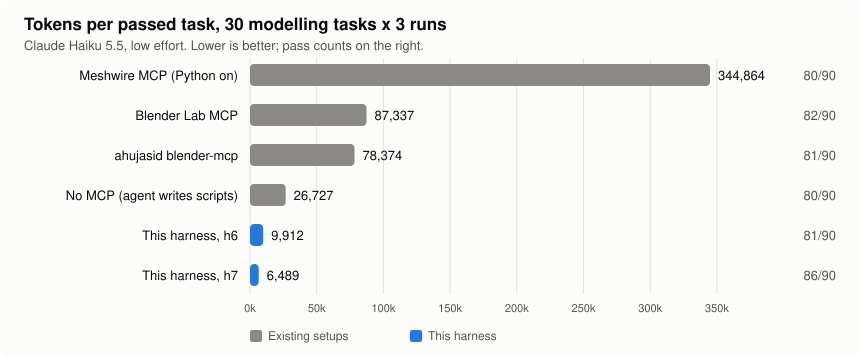

# What it costs an AI agent to model a product in Blender, and how to cut it to a quarter

*Phase 3 report, 2026-11-20. Draft for the blog post. Every number here comes from a dated entry in the journals; the recorded runs behind the h7 figures are attached to the `h7` release.*

## In short

AI agents can now drive Blender, but nobody had measured what that costs. I built a benchmark of 30 product-modelling tasks with automatic checks, ran four existing agent setups on it, and found they were equally accurate (about 90% of tasks passed) but differed in cost by more than ten times. The difference was overhead, not modelling. I then built a harness around where the tokens went. On the same tasks and model it passed 86 of 90 runs at 6,489 tokens per passed task: a quarter of the cheapest existing setup and a fiftieth of the heaviest. On eight tasks written only after it was frozen, it used about a fifth of the baseline's tokens per pass and finished in half the time. With the same harness, the four capable models I tried from other labs used between 1,800 and 18,000 tokens per pass. Tuning it on Claude Haiku cost under $3 of API spend.

## Why tokens

For a commercial CGI artist, the useful agent is one that models under direction: the artist keeps art direction, lighting and texturing, and hands off the geometry. The popular agent setups for Blender send hundreds of tool descriptions on every turn, check their work with screenshots, and lean on fragile scripts. Tokens are the cost, but they also set the speed (most of the wall time is the model writing) and how much of a long build fits in the model's memory. So the headline measure is tokens per passed task, with cost shown alongside and the pass rate as a guardrail: accuracy must not drop, but it isn't the claim.

## The benchmark

- **30 tasks,** all hypothetical products, in four groups: hard-surface parts (bottles, threaded caps, compacts, housings), client-style revisions to an existing model ("cap 10% taller", "move the holes", "soften that edge"), layouts, and long multi-part builds.
- **Automatic checks** on each: bounds and scale, watertight, self-intersections, volume from the spec, ray probes on named features, and names and counts.
- **The checks are checked.** Each task ships a reference model that must pass, deliberately broken versions that must fail exactly the checks they target, and a coarse build that must still pass. The very first real run still found a check that would have failed valid work (it assumed one way of building a thread). It was fixed and re-scored before any number was used.
- **Pass, fail or void.** A setup fault is void and rerun, never counted against the agent.
- **Held-out sets.** Four sets of eight tasks, each written only after a harness version was frozen and run once. Two independent builders remade the later sets' tasks from the prompt alone, to check the grading is fair.

One runner drives every setup, so the comparison is like for like. All headline runs use Claude Haiku 5.5 at low effort.

## Where existing setups spend their tokens

360 runs: 30 tasks, four setups, three repeats each, $2.77 in total, none void.

| Setup | Pass | Tokens per passed task | Against no MCP |
|---|---|---|---|
| No MCP (the agent writes its own scripts for headless Blender) | 80/90 | 26,727 | 1.0× |
| Community server (run any code, screenshot) | 81/90 | 78,374 | 2.9× |
| Blender's official server | 82/90 | 87,337 | 3.3× |
| 225-tool typed server (Python switched on) | 80/90 | 344,864 | 12.9× |

All four are equally accurate, so the difference is cost. Most of it is fixed overhead: tool definitions are 90% of the 225-tool server's input, 56% of the community server's and 38% of the official one's, and they are resent on every turn. With no MCP at all, the biggest single cost is the model's own earlier reasoning replayed on each turn (35%). Client revisions are the costliest group on every setup, because the agent has to measure the existing model before it can change it. Out of the box, the 225-tool server passed 5 of 15 pilot runs: the agent stopped to ask the user to switch on Python, which the server ships turned off.

## The harness

The agent gets one tool: run Python in a Blender session that stays open for the whole task. Around it:

- **A compact scene report after every call,** in place of the inspection code agents otherwise write: each object's size and face count, then generic problems (open edges, loose pieces, self-intersections, flipped normals, parts touching). It never sees the task's checks.
- **An opening read of the existing model** for revisions: the outline of a revolved part, round holes and their positions, repeated features with count and spacing, and each flat level's outline. These four facts came from mining 181 recorded revision runs: 40% of their calls were the agent measuring the model before its first edit, and 205 of those 210 calls were rebuilding one of these four.
- **Auto-finish:** a call marked final ends the run if it raised nothing and the report is clean, so the agent never pays to resend the whole conversation just to say it's done.
- **Small generic helpers** (primitives, a lathe, an exact boolean, cleanup) and bounded repair loops.

Each change was one variable, measured on the suite and recorded with its cost.

| Version | What changed | Pass | Tokens per passed task | Against no MCP |
|---|---|---|---|---|
| h4 | One tool, scene report, auto-finish, a millimetre constant | 82/90 | 9,773 | 0.37 |
| h5 | Fixed why repair loops got stuck | 79/90 | 8,202 | 0.31 |
| h7 | The opening read | 86/90 | 6,489 | 0.24 |

h7 took revisions from 21,908 tokens per pass to 5,174, and agents went from 1.8 inspection calls per revision to almost none. Runs take 12 seconds against no MCP's 32.

Two of the fixes along the way were to my own harness rather than the agent. The report gave sizes in millimetres, which agents read as metres, so they built models 1,000 times too large. And my cleanup helper was 100 times stricter than my report about what counts as a broken face, so agents hunted for faults they could never find.

## Held-out results

Development numbers can flatter a harness that has been tuned on those very tasks. Each held-out set was written after a version was frozen, then spent in one run.

| Set | Version | Pass, no MCP → harness | Tokens per pass, ratio | Typical task, ratio |
|---|---|---|---|---|
| First (hard) | h4 | 19/24 → 20/24 | 0.66 | 0.42 |
| Second (came out easy) | h5 | 22/24 → 24/24 | 0.22 | 0.27 |
| Third (hard) | h6 | 18/24 → 18/24 | 0.63 * | 0.43 * |
| Fourth (hard) | h7 | 18/24 → 20/24 | 0.21 | 0.27 |

\* Without one revision that defeated both setups and cost the baseline up to 1.6 million tokens a run. With it, the ratio is 0.12, which I don't claim.

The first set missed the target of half: two harness runs got stuck repairing a problem the report kept flagging, 13 and 14 calls long, and held half its tokens. That is what h5 fixed. The fourth set is the one that matters for h7: it uses about a fifth of the baseline's tokens per pass and a quarter on the typical task, at an equal or better pass rate and half the wall time. With the baseline's costliest task removed, it's still about a third (0.32 per pass, 0.34 typical). The second set came out easier than intended, which an independent review pointed out, so it's reported but not leaned on.

## What didn't work

- **Turning thinking off.** Thinking is most of what a small model writes, so I measured it switched off on both setups (180 runs). Each call got shorter, but agents needed more calls and passed less often: the baseline fell from 89% to 59% passing, and the harness used 25% more tokens per pass. Thinking stays on.
- **Resending only the latest reasoning.** It halved replay, but agents took slightly more calls without their earlier reasoning. The saving was inside the noise and it broke prompt caching, so cost went up.
- **Expected-size checks and a ring warning (h8).** A helper that compares the sizes the agent expects with what it built, and a warning on lathe profiles that never touch the axis. The warning fired only on parts meant to be rings, and the pair cost 18% more tokens for no visible gain. Not adopted.
- **A "real-world scale" line in the prompt.** The metres instruction was already there twice, and the models' own comments show they knew the sizes were in millimetres. The fix that worked was mechanical (below).

## Models from other labs

The harness was tuned on Haiku, so the obvious doubt is whether it only fixes Haiku's mistakes. I ran the same 30 tasks on Sonnet 5.5 and on five models from other labs through OpenRouter, each pinned to one provider. Before any of them wrote code, the agent's Blender moved into a container with no network, a read-only system and only its run folder writable. Replaying 30 sandboxed runs in ordinary Blender gave the same verdict and call count on every one.

| Model | Pass, no MCP → harness | Tokens per passed task, no MCP → harness | Ratio |
|---|---|---|---|
| Claude Haiku 5.5 | 80/90 → 86/90 | 26,727 → 6,489 | 0.24 |
| Claude Sonnet 5.5 | 79/90 → 82/90 | 10,103 → 3,828 | 0.38 |
| GPT-6.2 Sol | 29/30 → 30/30 | 3,620 → 1,798 | 0.50 |
| Gemini 4 Neon | 29/30 → 30/30 | 18,632 → 3,304 | 0.18 |
| Qwen 4 Max | 28/30 → 30/30 | 41,751 → 3,673 | 0.09 |
| DeepSeek V4.1 Flash | 26/30 → 28/30 † | 210,362 → 17,968 † | 0.09 |
| Mistral Small | 2/30 → 8/30 | 3.29M → 284k | |

† With h9 (below). On h7 DeepSeek passed 23/30 at 11,981.

Three things came out of it. The harness isn't Haiku-shaped: three of the four capable outside models passed every task with it. The saving measures how much a model wastes on its own, not how strong it is: with the harness, capable models converge on 2–4k tokens a task, so the lean GPT gains least and the wandering DeepSeek most. And there is a floor: Mistral Small can call the tool but can't model, and an 8B model couldn't make a valid tool call at all.

DeepSeek was the one model the harness first cost accuracy (87% to 77%). Four of its failures were models built 1,000 times too large that finished on a clean first call, before it read the sizes in the report. h9 holds a finishing call open once when any part is over 10 m across. Across all 525 recorded harness runs that line would have flagged six failures and no pass, since the largest part in any passing run is 0.36 m. In the next round it caught two such builds, both fixed and passed, and fired on nothing else.

## Limits

- **One model and setting for the headline:** Haiku 5.5 at low effort. The other models ran one round of 30, which is directional, and no held-out set was run on them.
- **Token counts across labs aren't directly comparable,** because each lab's tokenizer differs. Ratios within a model are.
- **The checks are geometric.** They catch wrong sizes, missing features and broken meshes, not whether a model looks good. A by-eye audit of 30 passes against their references found no difference, but the suite can't grade taste.
- **Thirty tasks is small,** and most are revolved or boxy hard-surface products. Organic forms aren't covered.
- **Changes under about 15% can't be told from noise** at the repeat counts I could afford (the method is in `eval-method.md`).

## What's next

Text briefs are the easy case. Clients send pictures, so the next experiment gives the agent rendered views of each product instead of, and alongside, the written brief, on the same tasks and checks, with and without the harness. After that comes a viewport that shows the agent's current step and lets an artist stop, undo and redirect it mid-build.

## Reproduce it

The tasks, checks, harness and runner are in this repository under GPL-3.0-or-later. The README lists the free checks (unit tests, the harness self-test, proving a task's checks against its reference) and the paid commands; the dated record of everything above is in `journal.md` and the earlier journals.
